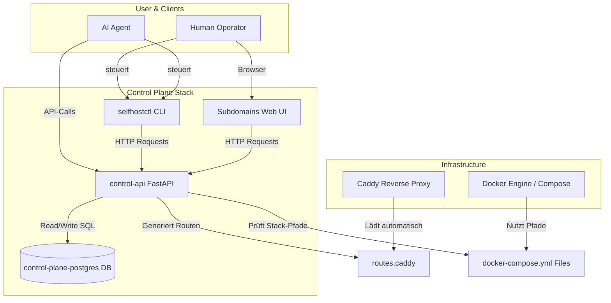
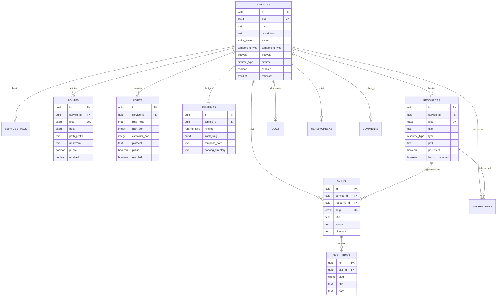
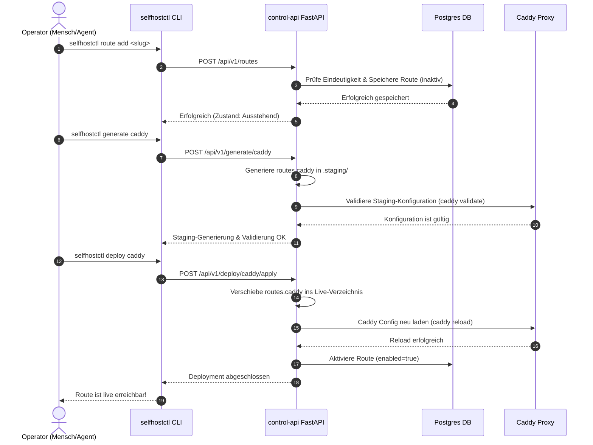

# Control Plane Architektur-Visualisierung

Diese Seite veranschaulicht die Funktionsweise und das Zusammenspiel der Selfhost Control Plane anhand verschiedener Diagramme.

## 1. Systemkomponenten und Datenflüsse

Das folgende Diagramm zeigt, wie Benutzer/Agenten über die CLI oder das WebUI mit der FastAPI-Anwendung interagieren, die wiederum die Postgres-Datenbank aktualisiert und Konfigurationsdateien für die Infrastruktur (wie Caddy und Docker Compose) generiert.

---

## 2. Datenmodell (ER-Diagramm)

Dieses Entity-Relationship-Diagramm veranschaulicht das relationale Datenmodell in PostgreSQL. Alle Fremdschlüssel-Beziehungen sind durch entsprechende Kardinalitäten gekennzeichnet.

---

## 3. Zweistufiges Deployment (Sequence Diagram)

Da Änderungen an Caddy-Routen riskant sind, trennt die Control Plane die Generierung (Staging & Validierung) vom eigentlichen Deployment (Apply). Dieses Sequenzdiagramm zeigt den Ablauf beim Registrieren und Veröffentlichen einer neuen Route.

